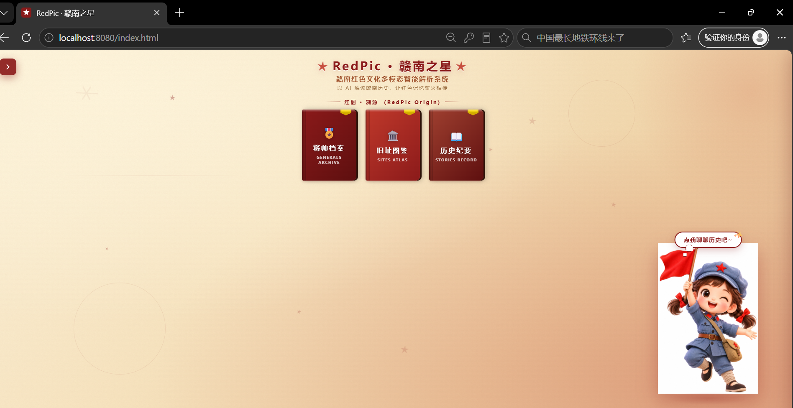
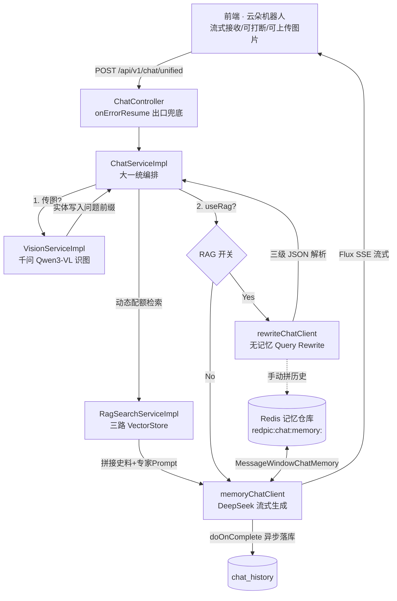
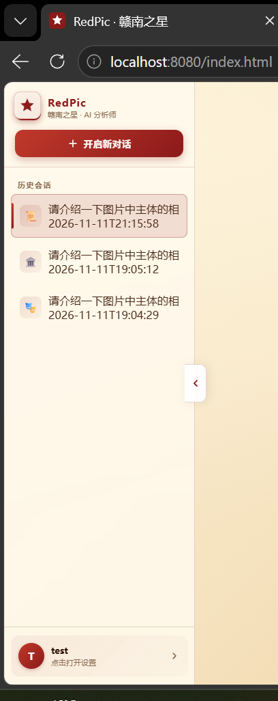
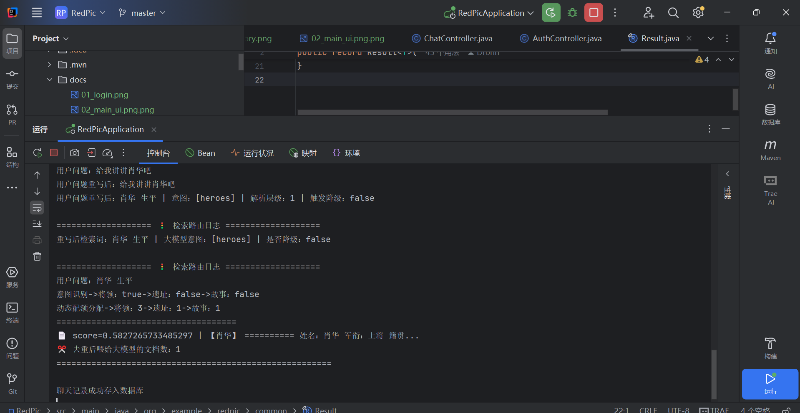
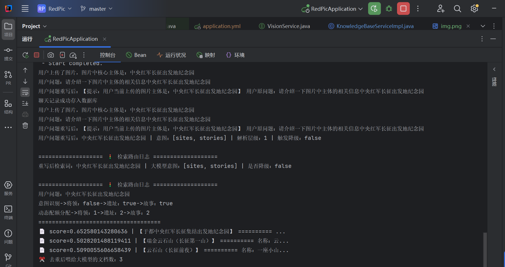
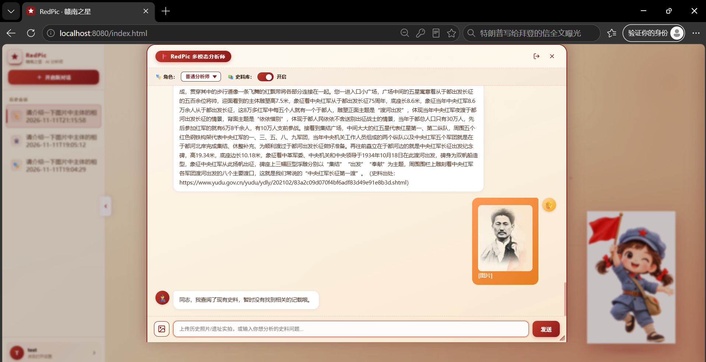
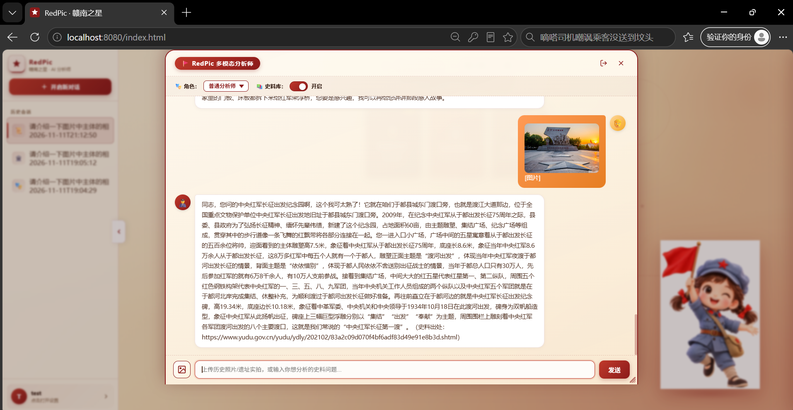
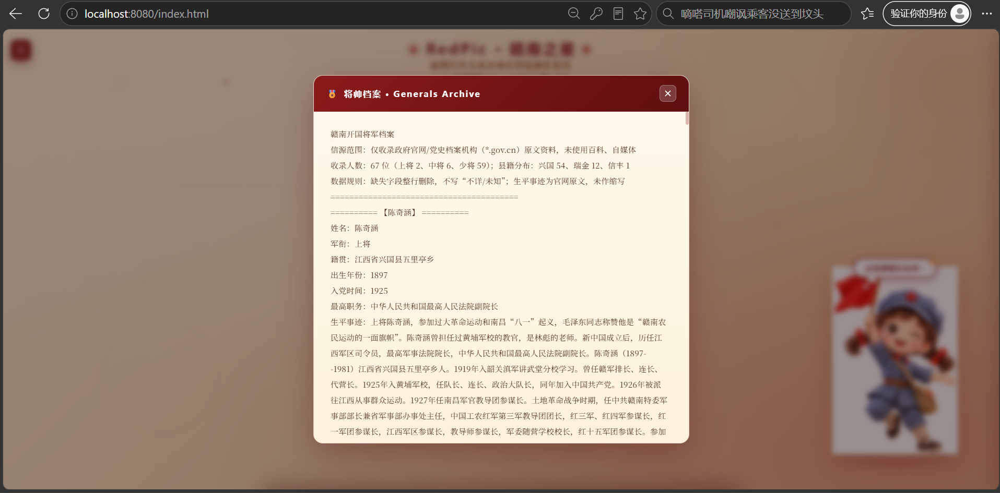
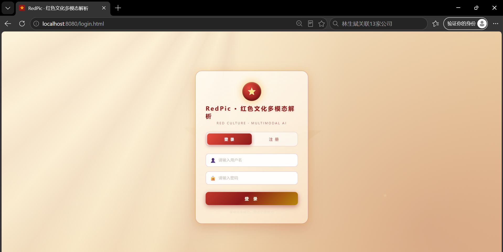

# ★ RedPic · 赣南之星 ★ — 赣南红色文化多模态智能解析系统

> **一句话定位**：以老照片/革命遗址图像识别为入口、RAG 史料检索为底座、大模型流式生成为输出的赣南红色文化智能导览系统。工程上基于 **Java 17 + Spring Boot 3.3.5 + Spring AI 1.0.0**，实现三模型混合编排、多轮记忆隔离、三级 JSON 解析降级、动态配额检索、防幻觉拦截等高可用能力。

---

## ✨ 核心特性速览

| 能力维度 | 技术实现 |
| :---: | :--- |
| 🧠 三模型混合编排 | 文本生成 **DeepSeek** / 向量嵌入 **智谱 Embedding-3** / 视觉识别 **阿里千问 Qwen3-VL-Plus**，`@Qualifier` 工厂隔离，Provider 热插拔 |
| 🌊 真·SSE 流式输出 | Spring AI `.stream().content()` + `Flux<String>` + `TEXT_EVENT_STREAM`，首字延迟毫秒级，支持前端 `AbortController` 打断 |
| 🧩 大一统八维路由 | 纯文本 / 多模态识图 / RAG 查库 × 专家·普通人设 × 记忆开关，统一收敛到 `/api/v1/chat/unified` |
| 🛡️ 三层防幻觉铁律 | 检索层阈值过滤 + Prompt 层"只能用史料"红线 + 输出层正则清洗兜底 |
| 💾 多轮记忆隔离 | Redis 持久化 `ChatMemoryRepository` + `MessageWindowChatMemory`(maxMessages=10) + rewrite 链路零记忆污染 |
| 🔐 Sa-Token 鉴权 | 拦截器白名单 + `@SaCheckLogin` 注解双保险，BCrypt 密码哈希，登录态 Token 下发 |

---

## 🖥️ 产品界面

<div align="center">

<br><b>图 1 · 3D 数字书架主界面 —— 以复古红色主题承载交互入口</b>
</div>

---

## 📐 系统架构



---

## 🔥 五大硬核技术亮点

### 亮点一 · 极致的序列化防御：Spring AI 多态反序列化的"黑洞"与手写 DTO 突围

**痛点**：Spring AI 的 `ChatMemory` 抽象将 `Message` 设计为多态接口族（`UserMessage` / `AssistantMessage` / `SystemMessage` …）。直接把 `List<Message>` 丢进 Jackson 序列化进 Redis 时，会写入大量框架私有字段（如 `metadata`、`messageType`、`toolCalls`），更致命的是——**反序列化时 Jackson 无法仅凭 JSON 还原多态类型**，要么抛 `InvalidTypeIdException`，要么把所有消息反序列化成基类导致 `getText()` 返回 null。这是 Spring AI + Redis 记忆方案的经典"多态黑洞"。

**方案**：放弃直接序列化框架对象，手写一个**极简 DTO `RedisMessageDto`**，只保留 `role` 与 `content` 两个业务字段，在 `RedisChatMemoryRepository` 的 `saveAll` / `findByConversationId` 中做**显式双向转换**：

```java
// 序列化：Message -> RedisMessageDto（只存 role + content）
List<RedisMessageDto> dtos = messages.stream().map(message -> {
    String role = message instanceof UserMessage ? "user" : "assistant";
    return new RedisMessageDto(role, message.getText());
}).collect(Collectors.toList());

// 反序列化：RedisMessageDto -> Message（手动 new 具体子类）
return dtos.stream().map(dto -> {
    if ("user".equals(dto.getRole())) return new UserMessage(dto.getContent());
    else return new AssistantMessage(dto.getContent());
}).collect(Collectors.toList());
```

**收益**：
- **彻底绕开多态反序列化陷阱**，Redis 中存储的 JSON 体积缩小 60% 以上（无框架噪音字段）；
- **框架升级零风险**：即使 Spring AI 后续修改 `Message` 内部结构，DTO 层作为防腐层（Anti-Corruption Layer）完全不受影响；
- **可读性极强**：`redis-cli` 直接 `GET` 即可看到干净的 `[{"role":"user","content":"xxx"}]`，运维排查友好。

---

### 亮点二 · 纯净上下文：rewrite 链路的记忆隔离设计

**痛点**：Query Rewrite（问题重写）的本质是让大模型"看懂上下文后把代词补全"。但如果直接复用带 `MessageChatMemoryAdvisor` 的 `memoryChatClient`，会产生两个致命问题：① rewrite 请求的"重写指令"会被写入记忆，污染主对话上下文；② 重写后的 JSON 结果也会作为 `assistant` 消息存进 Redis，下次检索时被当作历史回答喂回模型，造成**上下文毒化**。

**方案**：在 `AiModelConfig` 中显式拆分两个 `ChatClient` Bean：

| Bean 名称 | 是否挂载记忆 Advisor | 用途 |
| :---: | :---: | :--- |
| `memoryChatClient` | ✅ 挂载 `MessageChatMemoryAdvisor(aiChatMemory)` | 主对话生成，自动读写 Redis 记忆 |
| `rewriteChatClient` | ❌ 纯裸 `ChatClient`，无任何 Advisor | 问题重写，零记忆副作用 |

rewrite 所需的历史上下文**不走框架记忆**，而是通过 `buldRecentHistory(sessionId, 3)` 手动从 `aiChatMemory.get()` 只读拉取最近 3 轮，拼成纯文本 `{history}` 占位符注入 rewrite prompt：

```java
private String buildRecentHistory(String sessionId, int rounds) {
    List<Message> history = aiChatMemory.get(sessionId);   // get 只读，不触发写回
    int from = Math.max(0, history.size() - rounds * 2);
    return history.subList(from, history.size()).stream()
        .map(m -> (m.getMessageType() == MessageType.USER ? "用户" : "助手") + "：" + m.getText())
        .collect(Collectors.joining("\n"));
}
```

**收益**：
- **主对话记忆 100% 纯净**：rewrite 的 system / user / assistant 消息全部不落库，主对话上下文只含真实问答；
- **职责单一**：`rewriteChatClient` 是无状态工具人，`memoryChatClient` 只管主对话，符合单一职责原则；
- **可观测性提升**：日志中可清晰区分"重写请求"与"主对话请求"，排查上下文污染问题成本骤降。

<div align="center">

<br><b>图 2 · 多轮记忆隔离 —— 会话级 Redis Key 隔离，主对话上下文不被重写链路污染</b>
</div>

---

### 亮点三 · 大模型 JSON 状态机：parseRewriteResult 的三级降级高可用设计

**痛点**：让大模型输出 JSON 是 RAG 系统的常规操作，但大模型**从来不保证输出严格合法的 JSON**——可能带 ```json 代码块围栏、可能缺字段、可能输出非法标签、可能前后夹带解释性文字。如果直接 `ObjectMapper.readTree()` 一旦解析失败，整个 RAG 链路直接崩溃，用户看到的就是 500 错误。

**方案**：实现 `parseRewriteResult` **三级降级状态机**，每一级都有严格校验，失败则自动下沉：

| 级别 | 策略 | 校验规则 | parseLevel |
| :---: | :--- | :--- | :---: |
| **L1 标准解析** | Jackson `readTree` 解析 `{...}` 子串 | query 非空 && intent 非空 && 标签全在合法集 && `all` 不与其他混用 | 1 |
| **L2 正则抢救** | 正则提取 `"query":"xxx"` 与 `"intent":[...]` | 同上严格校验，去重 | 2 |
| **L3 Fallback 兜底** | 直接返回原问题 + `["all"]` 意图 | 标记 `fallback=true`，触发关键词路由 | 3 |

```java
// L1：截取最外层 {} 后 Jackson 解析 + 严格字段校验
int start = cleanResult.indexOf("{");
int end = cleanResult.lastIndexOf("}");
JsonNode node = new ObjectMapper().readTree(cleanResult.substring(start, end + 1));
// ... 校验 query 非空、intent 非空、无非法标签、all 不混用

// L2：正则抢救（应对 Jackson 解析失败但结构近似合法的情况）
Pattern qPattern = Pattern.compile("\"query\"\\s*:\\s*\"([^\"]+)\"");
Pattern iPattern = Pattern.compile("\"intent\"\\s*:\\s*\\[([^\\]]+)\\]");

// L3：完全降级 —— 原问题 + all 意图，保证链路不崩
return new RewriteResult(originalQuestion, List.of("all"), true, 3);
```

**收益**：
- **链路永不崩溃**：即使大模型输出完全乱码，L3 兜底仍能返回原问题走全库检索，用户体验不中断；
- **可观测**：`parseLevel` 与 `fallback` 字段直接打印日志，可统计大模型 JSON 合规率，反向优化 Prompt；
- **安全校验前置**：`all` 不与其他标签混用的约束在 L1/L2 都强制执行，避免检索路由逻辑被非法意图击穿。

---

### 亮点四 · RAG 动态配额与正则切分：对抗 Lost in the Middle

**痛点① —— 长文本稀释**：红色史料原文动辄数万字，若用 `TokenTextSplitter` 按 token 数硬切，会把一个人物的完整生平拦腰截断，导致向量语义碎片化，检索召回率断崖式下跌。

**方案① —— 语义边界正则切分**：史料原文用 `====【人物名】` 作为章节分隔符，在 `KnowledgeBaseServiceImpl` 中用 `split("=+\\s*【")` 按语义边界切分，再把 `【` 拼回每段开头：

```java
String[] sections = fullText.split("=+\\s*【");
for (int i = 1; i < sections.length; i++) {
    documents.add(new Document("【" + sections[i].trim()));
}
```

**痛点② —— Lost in the Middle**：大模型对长上下文中间位置的信息注意力会显著衰减（"迷失在中间"）。如果 5 条检索结果里 4 条是人物、1 条是遗址，模型很可能忽略那条遗址信息。

**方案② —— 意图驱动动态配额**：在 `RagSearchServiceImpl` 中，根据大模型识别的意图标签（heroes / sites / stories）动态分配 `topK` 配额：

| 命中意图数 | 配额策略 | 示例 |
| :---: | :--- | :--- |
| 0 或 3（全命中） | 平均分配 + 余数前置 | `3:1:1`（总 topK=5） |
| 1（单意图） | 命中库拿 3，其余各 1 | heroes 命中 → `3:1:1` |
| 2（双意图） | 命中库平分 4，未命中拿 1 | heroes+sites → `2:2:1` |

```java
if (hitCount == 0 || hitCount == 3) {
    int average = totalTopK / 3;          // 1
    qHeroes = average + (remainder > 0 ? 1 : 0);   // 2
    qSites  = average + (remainder > 1 ? 1 : 0);   // 2
    qStories = average;                    // 1
} else if (hitCount == 1) {
    int maxTopk = totalTopK - 2;          // 命中库拿 3
    ...
} else if (hitCount == 2) {
    int remainderTopk = totalTopK - 1;    // 未命中库保底 1
    int arg = remainderTopk / 2;          // 命中库平分 4
    ...
}
```

当 LLM 意图降级（fallback=true）时，自动切换到**关键词匹配路由**——用预定义的人物/遗址/故事关键词列表对 query 做 `anyMatch`，确保降级后仍有合理的配额分布。

**收益**：
- **语义完整度 100%**：每个人物/遗址/故事作为独立 Document，向量嵌入语义不被截断；
- **对抗中间迷失**：动态配额确保每个命中意图的库至少拿到 2 条以上结果，未命中库也保底 1 条防止漏召回；
- **降级可用**：三级 JSON 解析降级后，关键词路由接力，检索质量不崩盘。

<div align="center">

<br><b>图 3 · 单意图路由日志 —— 命中 heroes，配额分配 3:1:1</b>
</div>

<div align="center">

<br><b>图 4 · 多意图路由日志 —— 命中 heroes+sites+stories，配额分配 3:1:1</b>
</div>

---

### 亮点五 · 高可用流式与防幻觉拦截：绝不瞎编的铁律

**痛点① —— 流式链路异常吞没**：SSE 流式输出中，如果大模型中途抛异常（网络抖动、限流、超时），异常会直接抛到 Servlet 容器，前端收到的是半截回复 + 连接重置，用户体验极差且无法感知错误。

**方案① —— onErrorResume 出口兜底**：在 `ChatController` 的流式返回末端挂 `onErrorResume`，捕获所有异常后返回一句友好话术，保证流始终正常结束：

```java
return chatService.chat(...).onErrorResume(e -> {
    log.error("chat 流式异常", e);
    return Flux.just("同志，讲解过程中遇到了点问题，请稍后再试。");
});
```

**痛点② —— 红色历史题材的幻觉零容忍**：大模型在严肃历史题材中极易"编造"职务、时间、机构名称。红色文化内容一旦出错，性质远超普通问答场景。

**方案② —— 三层防幻觉拦截**：

| 层级 | 机制 | 实现位置 |
| :---: | :--- | :--- |
| **检索层** | 相似度阈值过滤（`SIMILARITY_THRESHOLD = 0.48`），低于阈值的文档直接丢弃，空结果返回空串触发兜底话术 | `RagSearchServiceImpl` |
| **Prompt 层** | System Prompt 强约束"只能用参考资料作答、核心主体未提及必须拒答、职务时间一字不差"，并对"知识库未收入"做特殊兜底 | `rag_default.st` / `rag_expert.st` |
| **输出层** | 检索空结果时注入固定文案"此问题本地知识库未收入"，Prompt 中要求模型原样输出拒答话术 | `ChatServiceImpl` |

**痛点③ —— 图像识别幻觉**：视觉模型对模糊老照片可能胡乱猜测人物身份。

**方案③ —— 实体拦截铁律**：`VisionServiceImpl` 返回识别结果后，在 `ChatServiceImpl` 中检测是否包含"未知/未识别/失败"，若是则**直接抛 `BizException`**，不走后续大模型与检索链路，从源头阻止错误实体进入上下文：

```java
if (imageEntity.contains("未知") || imageEntity.contains("未识别") || imageEntity.contains("失败")) {
    throw new BizException("同志，我未能看清图片中的核心主体，请换一张清晰的照片。");
}
```

**收益**：
- **流式链路永不崩溃**：`onErrorResume` 确保任何异常都转化为友好话术，前端永远收到完整流；
- **史实零编造**：检索阈值 + Prompt 红线 + 空结果兜底三重防线，模型在无史料时必须拒答，绝不东拼西凑；
- **错误实体零注入**：视觉识别失败时硬拦截，避免"张冠李戴"的错误主体污染后续 RAG 检索与生成。

<div align="center">

<br><b>图 5 · 防幻觉拒答 —— 知识库未命中时模型严格输出兜底话术，绝不编造</b>
</div>

<div align="center">

<br><b>图 6 · RAG 精准溯源 —— 回答末尾附史料出处，可查证</b>
</div>

<div align="center">

<br><b>图 7 · 官方原文查证 —— 点击可跳转史料原文，杜绝杜撰</b>
</div>

---

## 💎 深挖代码：那些容易被忽略的工程细节

### 细节一 · `@Qualifier` 解耦：三模型三路 VectorStore 的工厂化装配

**痛点**：项目同时依赖 DeepSeek（文本）、智谱（向量）、千问（视觉）三个模型 Provider，以及 heroes / sites / stories 三个独立向量库。如果用 `@Autowired` 默认按类型注入，Spring 容器中存在多个 `ChatModel` / `VectorStore` Bean 会直接报 `NoUniqueBeanDefinitionException`。

**方案**：在 `AiModelConfig` 与 `VectorStoreConfig` 中为每个 Bean 显式命名，注入端用 `@Qualifier` 精确指定：

```java
// AiModelConfig —— 三个 ChatClient，各司其职
@Bean("memoryChatClient")   // 带记忆，主对话
@Bean("rewriteChatClient")  // 无记忆，问题重写
@Bean("visionChatClient")   // 视觉识别

// VectorStoreConfig —— 三个 VectorStore，物理隔离
@Bean("heroesVectorStore")
@Bean("sitesVectorStore")
@Bean("storiesVectorStore")
```

**收益**：**Provider 热插拔**——未来把 DeepSeek 换成 GPT-4o，只需改 `AiModelConfig` 一处，业务层零感知；三个向量库物理隔离，人物/遗址/故事的检索互不干扰，配额分配逻辑才能成立。

### 细节二 · 全局异常 Result 体系：三层错误码统一收口

**痛点**：Controller 层如果每个方法都自己 try-catch，代码臃肿且错误码不统一，前端无法根据 code 做差异化处理。

**方案**：定义 `Result<T>` record 作为统一响应体，配合 `GlobalExceptionHandler` 三层拦截：

| 异常类型 | HTTP/业务码 | 响应 | 处理方式 |
| :---: | :---: | :--- | :--- |
| `NotLoginException` | 401 | `Result.forceLoginOut` | 前端跳转登录页 |
| `BizException` | 400 | `Result.bizError(msg)` | 前端弹红字提示用户 |
| `MethodArgumentNotValidException` | 400 | `Result.bizError(校验消息)` | 参数校验失败 |
| 其他 `Exception` | 500 | `Result.error(500, "系统开小差了")` | 兜底，不暴露堆栈 |

**收益**：**业务异常即业务语义**——`throw new BizException("图片未识别")` 即可让前端弹红字，无需在 Controller 写任何 try-catch；500 兜底永远不把堆栈暴露给用户。

### 细节三 · SSE `doOnComplete` 异步落库：流式与持久化的解耦

**痛点**：流式输出时，AI 回复是逐 token 到达的，如果每来一个 token 就写库，IO 压力巨大；如果流结束后同步写库，又会阻塞流的关闭。

**方案**：用 `StringBuilder fullAiResponse` 在流的 `map` 阶段累积完整回复，在 `doOnComplete` 回调中一次性写入 MySQL，且**全程 try-catch 吞掉异常**，确保落库失败不影响流本身：

```java
return memoryChatClient.prompt()...stream().content()
    .map(a -> { fullAiResponse.append(a); return a; })
    .doOnComplete(() -> {
        try {
            ChatHistory chatHistory = new ChatHistory();
            chatHistory.setUserMessage(finalQuestion);
            chatHistory.setAiMessage(fullAiResponse.toString().trim());
            chatHistoryMapper.insert(chatHistory);
        } catch (Exception e) {
            System.err.println("聊天记录存入数据库失败：" + e.getMessage());
        }
    });
```

**收益**：**落库与流式完全解耦**——写库再慢也不影响用户看到流式输出；写库失败不抛异常到流，用户无感知；`doOnComplete` 在 Reactor 线程执行，不占用请求线程。

### 细节四 · Stream API 链式去重：检索结果的精确投喂

**痛点**：三个 VectorStore 独立检索后合并，同一史料可能因分片重叠被多个库召回，重复喂给大模型会浪费 token 且干扰注意力。

**方案**：合并后用 Stream 链式调用去重：

```java
List<String> distinctTexts = docs.stream()
    .map(Document::getText)
    .distinct()
    .collect(Collectors.toList());
return String.join("\n", distinctTexts);
```

**收益**：**基于文本内容的精确去重**，避免相同史料重复投喂，节省 token 成本并降低 Lost in the Middle 风险。

### 细节五 · `LinkedHashMap` 保序 + 时间倒序：会话列表的工程化处理

**痛点**：用户有多个会话，需要按最后活跃时间倒序展示，且每个会话只显示第一条用户消息作为标题。

**方案**：`getUserSessions` 用 `LinkedHashMap` 按插入顺序去重，保留每个 session 的首条消息作标题，最后用 `Comparator` 按 `lastActiveTime` 倒序排序：

```java
Map<String, Map<String, Object>> sessionMap = new LinkedHashMap<>();
for (ChatHistory h : chatHistoriesList) {
    if (!sessionMap.containsKey(h.getSessionId())) {
        Map<String, Object> info = new HashMap<>();
        info.put("title", title.length() >= 15 ? title.substring(0, 15) + "..." : title);
        sessionMap.put(h.getSessionId(), info);
    } else {
        sessionMap.get(h.getSessionId()).put("lastActiveTime", h.getCreateTime());
    }
}
resultList.sort((a, b) -> timeB.compareTo(timeA));
```

**收益**：单次 SQL 查询 + 内存聚合完成会话列表构建，无需 `GROUP BY` 复杂查询；标题截断到 15 字符保证前端展示整洁。

---

## 🔐 Sa-Token 鉴权体系

| 机制 | 实现 |
| :---: | :--- |
| 拦截器白名单 | `SaTokenConfig` 拦截 `/api/**`，放行 login/register/logout |
| 注解兜底 | `ChatController` 类级 `@SaCheckLogin`，双保险 |
| 密码哈希 | `BCrypt.hashpw(password, BCrypt.gensalt())`，注册即哈希入库 |
| 登录态下发 | `StpUtil.login(userId)` → `StpUtil.getTokenValue()` 返回前端 |
| 改密即登出 | 修改密码后 `StpUtil.logout(userId)`，强制重新登录 |

<div align="center">

<br><b>图 8 · Sa-Token 鉴权 —— 登录注册与 Token 下发全流程</b>
</div>

---

## 🛠️ 技术栈全景

| 分类 | 选型 | 用途 |
| :---: | :--- | :--- |
| 语言 & 框架 | Java 17, Spring Boot 3.3.5 | 基础后端框架 |
| AI 编排 | Spring AI 1.0.0 | 统一模型抽象与 ChatClient 工厂 |
| 文本生成 | DeepSeek `deepseek-chat` | 主对话 + Query Rewrite |
| 视觉识别 | 阿里千问 `Qwen3-VL-Plus` | 老照片/遗址主体识别 |
| 向量嵌入 | 智谱 `embedding-3` | 中文史料向量化 |
| 向量存储 | Spring AI `SimpleVectorStore` | 本地 JSON 快照持久化 |
| 流式传输 | Spring WebFlux `Flux` + SSE | 打字机流式输出 |
| 持久化 | MySQL 8 + MyBatis-Plus 3.5.7 | 用户/聊天记录 |
| 缓存记忆 | Redis + Lettuce 连接池 | 多轮对话记忆 |
| 鉴权 | Sa-Token 1.38.0 | 登录态与接口拦截 |
| 密码安全 | BCrypt | 密码哈希存储 |

---

## 🚀 环境启动指南

### 1. 基础环境

| 依赖 | 版本要求 | 说明 |
| :---: | :---: | :--- |
| JDK | 17+ | 项目使用 Java 17 语法（record、switch 表达式等） |
| Maven | 3.8+ | 依赖管理 |
| MySQL | 8.0+ | 用户表 & 聊天记录表 |
| Redis | 6.0+ | 对话记忆存储，需开启 |

### 2. 数据库初始化

```sql
CREATE DATABASE redpic DEFAULT CHARACTER SET utf8mb4;

CREATE TABLE sys_user (
    user_id BIGINT PRIMARY KEY AUTO_INCREMENT,
    username VARCHAR(64) NOT NULL UNIQUE,
    password VARCHAR(128) NOT NULL,
    create_time DATETIME
);

CREATE TABLE chat_history (
    id BIGINT PRIMARY KEY AUTO_INCREMENT,
    user_id VARCHAR(64) NOT NULL,
    session_id VARCHAR(128) NOT NULL,
    user_message TEXT,
    ai_message TEXT,
    image_url VARCHAR(256),
    create_time DATETIME
);
```

### 3. 配置 API Key

复制 `application-example.yml` 为 `application.yml`，填入三个模型的 API Key：

```yaml
spring:
  ai:
    deepseek:
      api-key: sk-xxxxxxxx        # DeepSeek 文本生成
    zhipuai:
      api-key: xxxxxxxx.siUiXXX   # 智谱 Embedding-3 向量
    openai:
      base-url: https://dashscope.aliyuncs.com/compatible-mode
      api-key: sk-xxxxxxxx        # 阿里千问视觉（OpenAI 兼容模式）
  datasource:
    url: jdbc:mysql://localhost:3306/redpic?useUnicode=true&characterEncoding=utf8&serverTimezone=Asia/Shanghai
    username: root
    password: your_password
  data:
    redis:
      host: 127.0.0.1
      port: 6379
```

### 4. 启动服务

```bash
# 克隆项目
git clone https://github.com/your-name/redpic.git
cd redpic

# 启动（默认 8080 端口）
mvn spring-boot:run
```

启动成功后访问 `http://localhost:8080` 即可使用。

### 5. 知识库导入

将红色史料文件命名为包含 `generals` / `sites` / `stories` 的文本文件，调用接口导入：

```bash
curl -X POST http://localhost:8080/api/knowledge/upload \
  -F "file=@ruijin_generals.txt"
```

---

## 📂 项目结构

```text
redpic/
├── src/main/java/org/example/redpic/
│   ├── controller/
│   │   ├── ChatController.java        # 大一统流式接口 + onErrorResume 兜底
│   │   ├── AuthController.java        # 登录/注册/改密
│   │   └── KnowledgeController.java   # 知识库导入/原文读取
│   ├── service/impl/
│   │   ├── ChatServiceImpl.java       # 核心编排：识图→重写→RAG→流式生成→落库
│   │   ├── RagSearchServiceImpl.java  # 三路 VectorStore 动态配额检索
│   │   ├── VisionServiceImpl.java     # 千问视觉识图
│   │   └── AuthServiceImpl.java       # BCrypt + Sa-Token 鉴权
│   ├── config/
│   │   ├── AiModelConfig.java         # 三个 ChatClient 工厂（记忆/重写/视觉）
│   │   ├── VectorStoreConfig.java     # 三个 VectorStore（人物/遗址/故事）
│   │   ├── AiChatMemoryConfig.java    # MessageWindowChatMemory(maxMessages=10)
│   │   └── SaTokenConfig.java         # 拦截器白名单
│   ├── repository/
│   │   └── RedisChatMemoryRepository.java  # Redis 记忆仓库 + DTO 双向转换
│   ├── dto/
│   │   └── RedisMessageDto.java       # 极简序列化 DTO（防多态黑洞）
│   ├── common/
│   │   └── Result.java                # 统一响应体 record
│   └── exception/
│       ├── GlobalExceptionHandler.java    # 三层异常拦截
│       └── BizException.java              # 业务异常
├── src/main/resources/
│   ├── prompts/                     # 外置 Prompt 模板（default/expert/rag_*/rewrite/vision）
│   ├── application-example.yml      # 配置模板
│   └── application.yml              # 实际配置
└── vector_heroes/sites/stories.json # 本地向量库快照
```

---

## 🧭 设计哲学总结

| 原则 | 落地体现 |
| :---: | :--- |
| **高可用优先** | 三级 JSON 降级、onErrorResume 兜底、空结果拒答、视觉实体硬拦截 |
| **解耦至上** | @Qualifier 工厂隔离三模型、rewrite 零记忆、RagSearch 纯工具化 |
| **上下文纯净** | DTO 防腐层绕开多态序列化、手动拼历史避免记忆毒化 |
| **对抗幻觉** | 检索阈值 + Prompt 红线 + 空结果兜底，史料未命中绝不编造 |
| **可观测** | parseLevel / fallback 字段、检索路由日志、去重前后文档数打印 |

> **这个项目证明了：在大模型应用工程化中，真正的难点从来不是"调通 API"，而是在不可靠的模型输出之上，用工程手段构建出可靠的业务系统。**