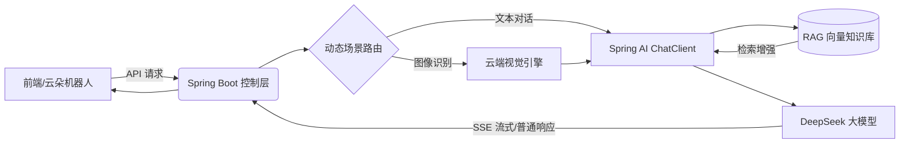

# RedPic 红图 · 红色文化AI图像识别讲解系统

基于 Java 17 + Spring Boot 3.3.5 + Spring AI 打造的红色文旅智能识别项目。核心能力为红色老照片、革命遗址实拍图的自动识别与专业讲解，配套多轮对话、RAG 知识库检索等能力，以图像为核心载体，数字化传承红色文化。

## 📐 系统架构



## 核心功能

- 🖼️ **红色图像识别讲解（核心）**：上传红色老照片、革命遗址实拍图，自动识别画面主体，结合史料输出专业历史背景与故事讲解。
- 💬 **专属讲解员多轮对话**：红色文旅垂直人设，基于动态 Prompt 路由支持日常讲解与专家学术双模式无缝切换。
- 📚 **RAG 知识库检索问答**：基于本地红色史料知识库作答，内容精准权威，从根源减少大模型幻觉。
- 🛡️ **企业级工程规范**：统一返回体、参数校验、全局异常兜底、Token 成本控制、配置与业务解耦。

## 技术栈

- 后端框架：Java 17, Spring Boot 3.3.5
- AI 引擎：Spring AI 1.0.0, DeepSeek 大模型
- 架构设计：MVC分层架构、面向接口编程、策略路由模式
- 工程规范：统一响应结构、全局异常处理、参数校验、基于 ClassPathResource 的外部模板动态加载

## 功能实现进度

- ✅ 基础接口规范：统一返回体、参数校验、全局异常兜底
- ✅ 多轮上下文记忆与会话隔离：基于 Advisor 与 SessionId 实现
- ✅ 动态 Prompt 模板：实现变量注入，支持根据不同用户类型切换专家/普通模式
  - ✅ 多模态 Prompt 预埋：已完成针对图像识别结果的专属 Prompt 约束设计（待接口联调）
- ⏳ RAG 检索增强问答：本地知识库切片、文本嵌入 (Embedding)、向量数据库检索与来源引用
- ⏳ 多模态红色图像识别讲解：对接云端视觉引擎，打通识图-检索-生成链路
- ⏳ 流式输出 (SSE)：实现打字机效果，结合异步线程池降低首字延迟并优化并发阻塞
- ⏳ 前端云朵机器人交互与接口联调
- ⏳ 接口安全加固：限流、全链路日志、敏感词过滤
- ⏳ 服务器部署与线上发布：Docker 容器化

## 本地运行

1. 复制 `application-example.yml` 为 `application.yml`，填入自己的 API Key
2. 启动启动类 `RedPicApplication`，服务默认运行在 8080 端口
3. 调用对话接口测试多轮对话与动态人设能力（以专家模式为例）：

```json
{
  "message": "给我讲讲兴国",
  "type": "expert"
}
```