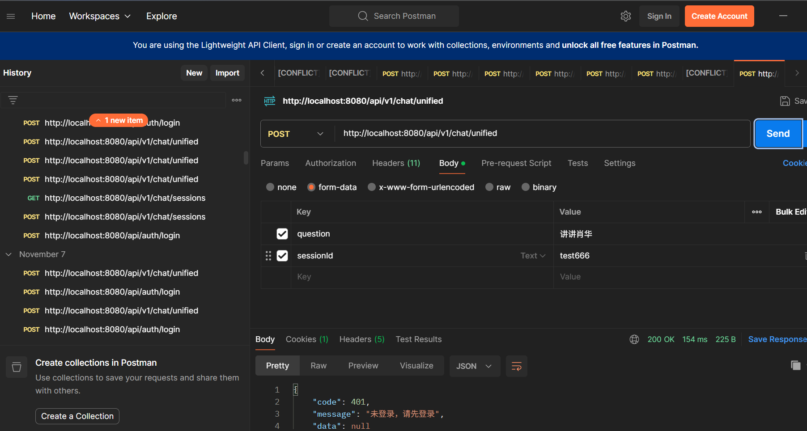
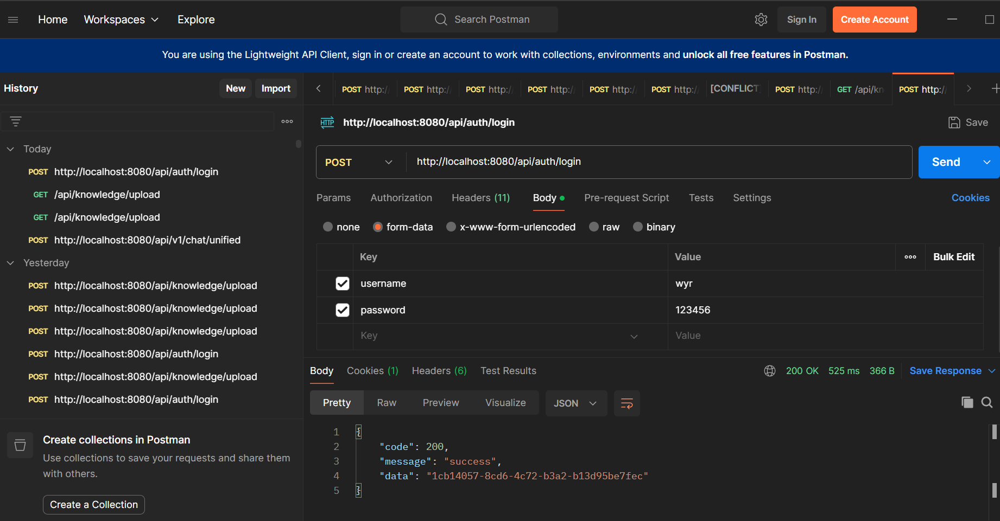
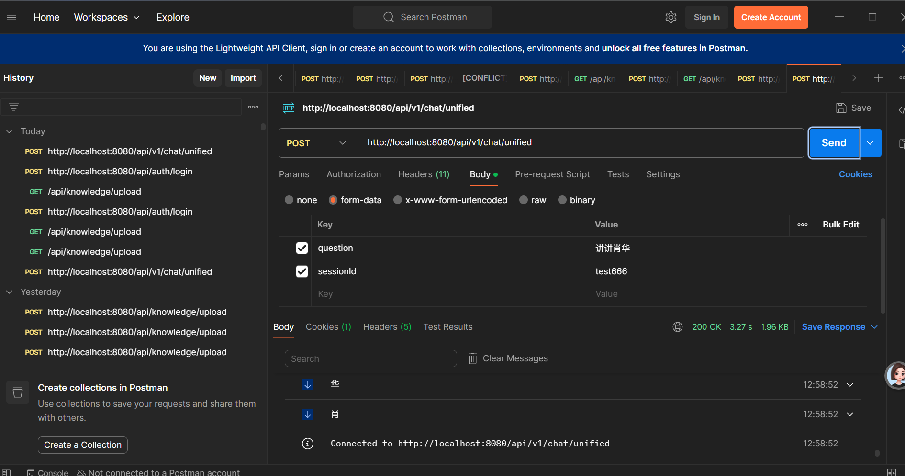

# 接口安全测试 · RedPic

> 本页验证 RedPic 接口层的 Sa-Token 鉴权全流程，涵盖未登录拦截、Token 获取与登录后流式放行三个环节。

---

## 鉴权体系总览

| 环节 | 机制 | 实现 |
| :---: | :--- | :--- |
| 拦截层 | `SaTokenConfig` 拦截器 | 拦截 `/api/**`，白名单放行 login/register/logout |
| 注解层 | `@SaCheckLogin` | Controller 类级注解双保险 |
| 存储层 | Sa-Token Token 会话 | 默认内存存储，可扩展 Redis |
| 密码层 | BCrypt 哈希 | `BCrypt.hashpw(password, BCrypt.gensalt())` |

---

## 流程一 · 未登录请求拦截

未携带有效 Token 的请求被拦截器拦截，返回 401 强制登录。

 <b>图 1 · 未登录拦截 —— 无 Token 或 Token 失效时，请求被 Sa-Token 拦截器拦截并返回 401</b>

**拦截逻辑**：
- `SaTokenConfig` 配置 `SaInterceptor` 拦截 `/api/**`
- `GlobalExceptionHandler` 捕获 `NotLoginException`，返回 `Result.forceLoginOut`
- 前端根据 code=401 跳转登录页

---

## 流程二 · 登录获取 Token

调用登录接口，校验用户名密码后由 Sa-Token 生成 Token 下发。

 <b>图 2 · 登录获取 Token —— 校验 BCrypt 密码后调用 StpUtil.login 下发 Token</b>

**登录流程**：
1. 前端提交用户名 + 明文密码
2. `AuthServiceImpl` 从数据库取出 BCrypt 哈希值
3. `BCrypt.checkpw(plainPassword, hashedPassword)` 校验
4. 校验通过 → `StpUtil.login(userId)` → `StpUtil.getTokenValue()` 返回 Token
5. 前端将 Token 存入 localStorage，后续请求放入 `Authorization` 头

---

## 流程三 · 登录后流式放行

携带有效 Token 的请求正常放行，SSE 流式输出正常返回。

 <b>图 3 · 登录后流式放行 —— Token 校验通过，SSE 流式打字机输出正常返回</b>

**放行逻辑**：
- 拦截器校验 `StpUtil.isLogin()` 通过，请求进入 Controller
- `@SaCheckLogin` 注解二次校验，双保险
- `ChatController` 返回 `Flux<String>` 流式响应，前端逐 token 渲染

---

## 安全设计要点

| 设计点 | 说明 |
| :--- | :--- |
| **改密即登出** | 修改密码后调用 `StpUtil.logout(userId)`，强制所有设备重新登录 |
| **密码哈希** | BCrypt 自带盐值，相同密码每次哈希结果不同，防止彩虹表攻击 |
| **白名单最小化** | 仅 login/register/logout 放行，其余接口全部需鉴权 |
| **异常不泄露** | 500 兜底返回"系统开小差了"，不暴露堆栈与内部错误 |

---

> **相关文档**：
> - 🔙 [返回主 README](../../README.md)
> - 🖥️ [前端功能展示](../ui/ui.md)
> - 🧠 [多轮记忆与指代消解](../memory/memory.md)
> - 🛡️ [RAG 动态路由测试](../logs/logs.md)