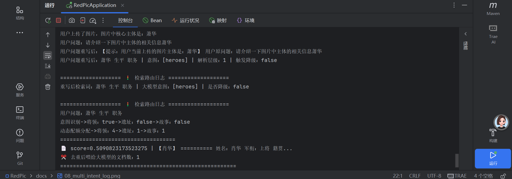
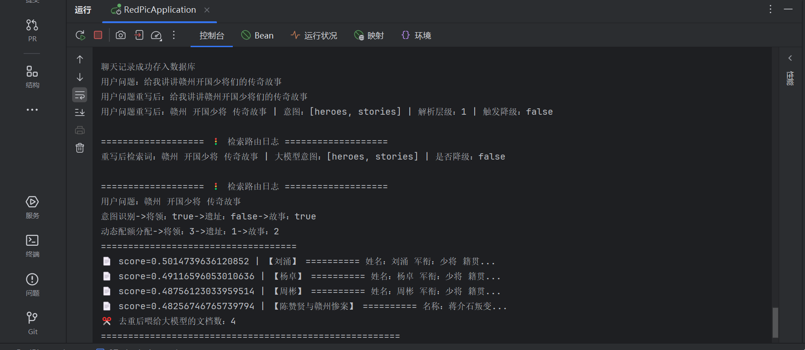
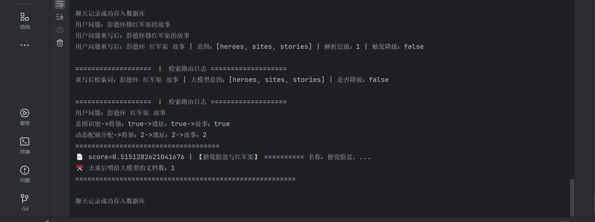

# RAG 动态路由测试 · RedPic

> 本页记录 RedPic RAG 检索的动态配额路由算法验证，覆盖单意图、双意图、多意图三种典型场景。
> **当前算法版本：TopK = 6**

---

## 算法核心：意图驱动动态配额

大模型对长上下文中间位置的信息注意力会显著衰减（Lost in the Middle）。若检索结果中某一意图库占比过高，其他意图的信息容易被模型忽略。

`RagSearchServiceImpl` 根据大模型识别的意图标签（`heroes` / `sites` / `stories`）动态分配 `topK` 配额，确保每个命中意图的库都有足够召回。

### 配额规则表（TopK = 6）

| 命中意图数 | 配额策略 | 配额分配 | 适用场景 |
| :---: | :--- | :---: | :--- |
| **1（单意图）** | 命中库拿 4，其余各保底 1 | `4:1:1` | 用户明确只问人物/遗址/故事 |
| **2（双意图）** | 命中库平分 5，未命中保底 1 | `3:1:2` | 用户问"某人的某事件" |
| **3 或 0（多意图/全库）** | 三库均分 | `2:2:2` | 泛化问题或意图降级 |

### 降级接力

当大模型 JSON 解析失败触发 `fallback=true` 时，自动切换到**关键词匹配路由**——用预定义的人物/遗址/故事关键词列表对 query 做 `anyMatch`，确保降级后仍有合理的配额分布。

---

## 场景一 · 单意图命中（4:1:1）

用户问题只涉及单一维度（如只问人物），命中库拿 4 条，其余两库各保底 1 条防止漏召回。

 <b>图 1 · 单意图路由日志 —— 命中 heroes 意图，配额分配 4:1:1（将领 4 / 遗址 1 / 故事 1）</b>

**日志解读**：
- 意图识别 → 将领：true / 遗址：false / 故事：false
- 动态配额分配 → 将领：4 / 遗址：1 / 故事：1
- 总计 6 条，命中库占比最高，未命中库保底防止漏召

---

## 场景二 · 双意图命中（3:1:2）

用户问题涉及两个维度（如人物 + 故事），两个命中库平分 5 条，未命中库保底 1 条。

 <b>图 2 · 双意图路由日志 —— 命中 heroes + stories 意图，配额分配 3:1:2（将领 3 / 遗址 1 / 故事 2）</b>

**日志解读**：
- 意图识别 → 将领：true / 遗址：false / 故事：true
- 动态配额分配 → 将领：3 / 遗址：1 / 故事：2
- 命中库共分 5 条（3+2），未命中的遗址库保底 1 条

---

## 场景三 · 多意图命中（2:2:2）

用户问题涉及全部三个维度，或意图识别降级为 `all`，三库均分 TopK=6。

 <b>图 3 · 多意图路由日志 —— 命中 heroes + sites + stories，配额分配 2:2:2（均分）</b>

**日志解读**：
- 意图识别 → 将领：true / 遗址：true / 故事：true
- 动态配额分配 → 将领：2 / 遗址：2 / 故事：2
- 三库均分，防止单一维度信息过载导致 Lost in the Middle

---

## 检索质量保障

| 机制 | 实现 | 收益 |
| :---: | :--- | :--- |
| 相似度阈值 | `SIMILARITY_THRESHOLD = 0.48` | 低于阈值的文档直接丢弃 |
| 内容去重 | `stream().map(Document::getText).distinct()` | 避免重复史料浪费 token |
| 空结果兜底 | `docs.isEmpty()` 返回空串 | 触发防幻觉拒答话术 |
| 可观测日志 | 打印意图/配额/每条文档 score | 便于排查召回质量 |

---

> **相关文档**：
> - 🔙 [返回主 README](../../README.md)
> - 🖥️ [前端功能展示](../ui/ui.md)
> - 🧠 [多轮记忆与指代消解](../memory/memory.md)
> - 🔐 [接口安全测试](../api/api.md)