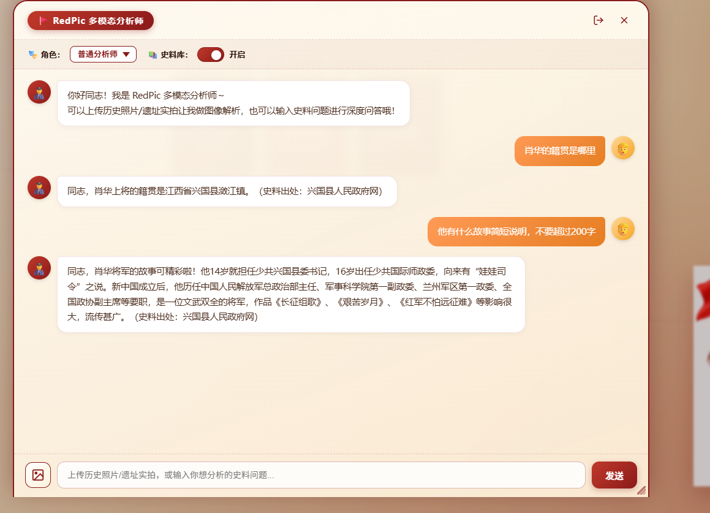
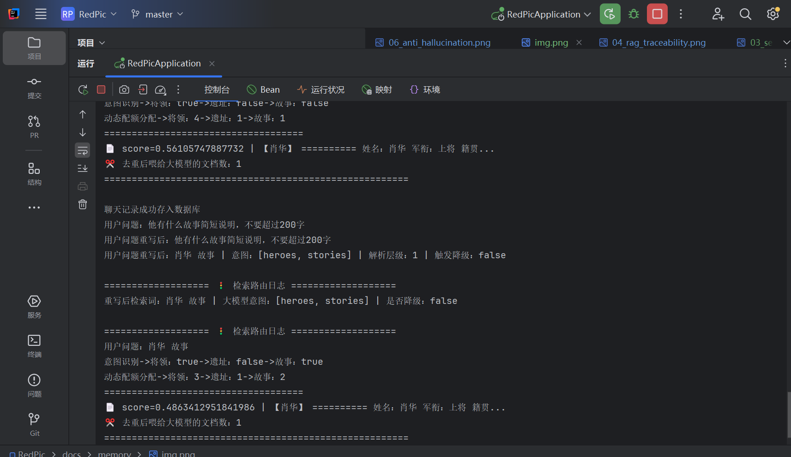

# 多轮记忆与指代消解 · RedPic

> 本页展示 RedPic 的多轮对话记忆隔离与 Query Rewrite 指代消解能力，核心是**无记忆 rewrite 链路**与 **Redis 记忆物理隔离**的双重设计。

---

## 记忆架构设计

| 组件 | 职责 | 实现 |
| :---: | :--- | :--- |
| `memoryChatClient` | 主对话生成，自动读写 Redis 记忆 | 挂载 `MessageChatMemoryAdvisor` |
| `rewriteChatClient` | 问题重写，零记忆副作用 | 纯裸 `ChatClient`，无任何 Advisor |
| `aiChatMemory` | 滑动窗口记忆 | `MessageWindowChatMemory(maxMessages=10)` |
| `RedisChatMemoryRepository` | Redis 持久化 | DTO 双向转换绕开多态序列化 |

---

## 核心问题：为什么 rewrite 不能用带记忆的 ChatClient？

**痛点**：Query Rewrite 的本质是让大模型"看懂上下文后把代词补全"。但如果直接复用带 `MessageChatMemoryAdvisor` 的 `memoryChatClient`，会产生两个致命问题：

1. **rewrite 的"重写指令"会被写入记忆**，污染主对话上下文
2. **重写后的 JSON 结果也会作为 `assistant` 消息存进 Redis**，下次检索时被当作历史回答喂回模型，造成上下文毒化

**方案**：在 `AiModelConfig` 中显式拆分两个 `ChatClient` Bean：

| Bean 名称 | 是否挂载记忆 Advisor | 用途 |
| :---: | :---: | :--- |
| `memoryChatClient` | ✅ 挂载 `MessageChatMemoryAdvisor(aiChatMemory)` | 主对话生成，自动读写 Redis 记忆 |
| `rewriteChatClient` | ❌ 纯裸 `ChatClient`，无任何 Advisor | 问题重写，零记忆副作用 |

rewrite 所需的历史上下文**不走框架记忆**，而是通过 `buildRecentHistory(sessionId, 3)` 手动从 `aiChatMemory.get()` 只读拉取最近 3 轮，拼成纯文本 `{history}` 占位符注入 rewrite prompt：

```java
private String buildRecentHistory(String sessionId, int rounds) {
    List<Message> history = aiChatMemory.get(sessionId);   // get 只读，不触发写回
    int from = Math.max(0, history.size() - rounds * 2);
    return history.subList(from, history.size()).stream()
        .map(m -> (m.getMessageType() == MessageType.USER ? "用户" : "助手") + "：" + m.getText())
        .collect(Collectors.joining("\n"));
}
```

---

## 场景演示 · 指代消解

用户多轮对话中使用代词（如"他"、"那里"），rewrite 链路将其补全为具体实体后再检索。

### 前端追问界面

<div align="center">

<br><b>图 1 · 多轮追问前端 —— 用户使用代词"他"进行追问，系统正确理解指代对象</b>
</div>

**对话示例**：
- 用户第一轮："陈奇涵是谁？"
- 助手回答：陈奇涵的生平介绍
- 用户第二轮："他是哪里人？" ← 使用代词"他"
- rewrite 后检索词："陈奇涵是哪里人？" ← 代词被补全为具体人名

### 后台重写日志

<div align="center">

<br><b>图 2 · 后台重写日志 —— rewriteChatClient 无记忆执行，输出 JSON 包含补全后的 query 与意图标签</b>
</div>

**日志解读**：
- rewrite 请求携带手动拼接的最近 3 轮历史
- `rewriteChatClient` 执行后输出结构化 JSON：`{"query": "补全后的检索词", "intent": ["heroes", "sites"]}`
- 重写结果仅用于 RAG 检索，**不写入 Redis 记忆**
- 主对话记忆仅包含真实的用户提问与助手回答

---

## Redis 记忆序列化防御

Spring AI 的 `Message` 是多态接口族（`UserMessage` / `AssistantMessage` / `SystemMessage`），直接用 Jackson 序列化进 Redis 会触发多态反序列化黑洞。

**方案**：手写极简 DTO `RedisMessageDto`，只保留 `role` 与 `content` 两个字段，在 `RedisChatMemoryRepository` 中做显式双向转换：

```java
// 序列化：Message -> RedisMessageDto
List<RedisMessageDto> dtos = messages.stream().map(message -> {
    String role = message instanceof UserMessage ? "user" : "assistant";
    return new RedisMessageDto(role, message.getText());
}).collect(Collectors.toList());

// 反序列化：RedisMessageDto -> Message
return dtos.stream().map(dto -> {
    if ("user".equals(dto.getRole())) return new UserMessage(dto.getContent());
    else return new AssistantMessage(dto.getContent());
}).collect(Collectors.toList());
```

**收益**：
- 彻底绕开多态反序列化陷阱
- Redis 存储 JSON 体积缩小 60% 以上
- 框架升级零风险，DTO 作为防腐层完全隔离框架内部结构

---

## 记忆隔离效果

| 维度 | 效果 |
| :---: | :--- |
| 主对话记忆纯净度 | 零污染 —— rewrite 消息全部不落库 |
| 会话隔离 | 每个 `sessionId` 独立 Redis Key，互不干扰 |
| 上下文长度控制 | `maxMessages=10` 滑动窗口，防止 token 溢出 |
| 可观测性 | 日志清晰区分"重写请求"与"主对话请求" |

---

> **相关文档**：
> - 🔙 [返回主 README](../../README.md)
> - 🖥️ [前端功能展示](../ui/ui.md)
> - 🛡️ [RAG 动态路由测试](../logs/logs.md)
> - 🔐 [接口安全测试](../api/api.md)