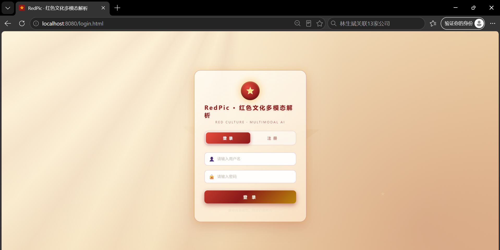
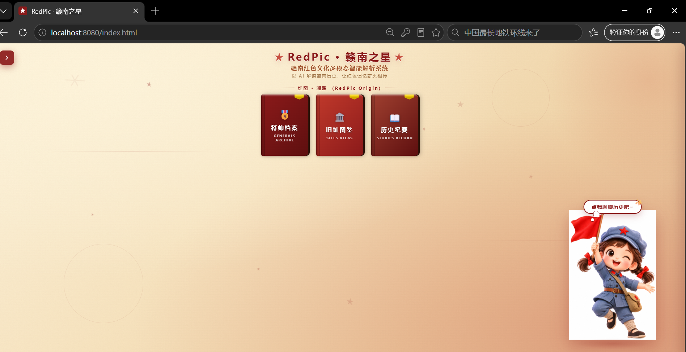
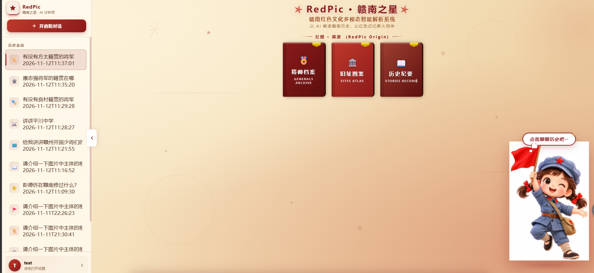
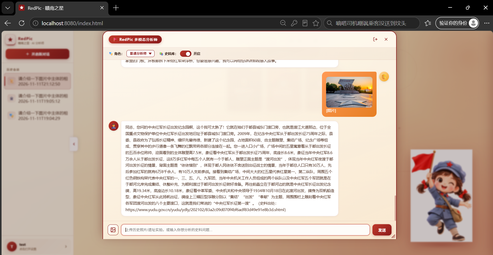
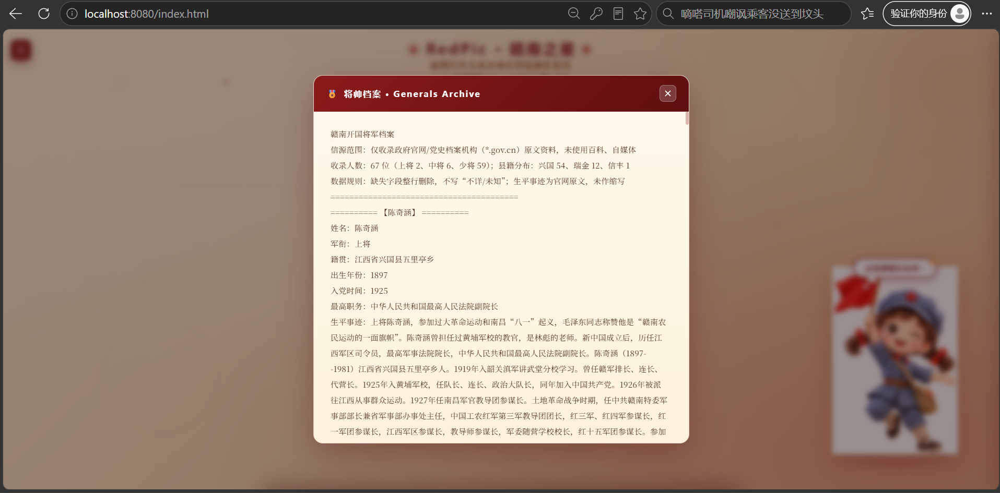
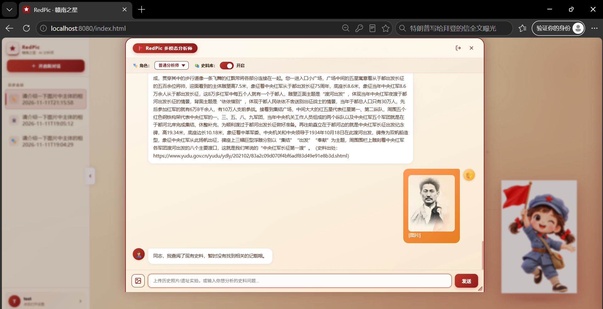

# 前端功能展示 · RedPic

> 本页展示 RedPic 系统的核心前端交互能力，涵盖登录鉴权、3D 数字书架、多轮记忆隔离、RAG 精准溯源、官方原文查证与防幻觉拒答六大场景。

---

## 功能总览

| 序号 | 功能模块 | 核心能力 | 技术支撑 |
| :---: | :--- | :--- | :--- |
| 1 | Sa-Token 鉴权登录 | 用户名/密码登录、Token 下发、未登录拦截 | Sa-Token 1.38 + BCrypt |
| 2 | 3D 数字书架主界面 | 复古红色主题、书架式导航、对话入口 | 原生 HTML/CSS/JS |
| 3 | 多轮记忆隔离 | 会话级历史留存、指代消解、上下文不串台 | Redis + MessageWindowChatMemory |
| 4 | RAG 精准溯源 | 回答末尾附史料出处、相似度分数可见 | Spring AI VectorStore |
| 5 | 官方原文查证 | 点击出处跳转史料原文、杜绝杜撰 | 本地私有史料库 |
| 6 | 防幻觉拒答 | 无史料命中时输出兜底话术、绝不编造 | 阈值过滤 + Prompt 红线 |

---

## 1. Sa-Token 鉴权登录

 <b>图 1 · Sa-Token 鉴权 —— 登录注册与 Token 下发，未登录请求被拦截器拦截</b>

- 登录成功后由 `StpUtil.login(userId)` 生成 Token 返回前端
- 后续请求通过 `Authorization: Bearer <token>` 携带身份
- `SaTokenConfig` 拦截 `/api/**`，白名单放行 login/register/logout
- 密码采用 `BCrypt.hashpw` 哈希存储，改密即登出

---

## 2. 3D 数字书架主界面

 <b>图 2 · 3D 数字书架主界面 —— 复古红色主题承载交互入口，支持文字与图片双模态提问</b>

- 主界面采用 3D 立体书架设计，红色文化主题视觉
- 支持纯文本提问与上传老照片/遗址图像识别两种入口
- 流式打字机输出，支持前端 `AbortController` 打断

---

## 3. 多轮记忆隔离

 <b>图 3 · 多轮记忆隔离 —— 会话级 Redis Key 隔离，支持指代消解，主对话上下文不被重写链路污染</b>

- 每个会话对应独立 Redis Key `redpic:chat:memory:{sessionId}`
- `MessageWindowChatMemory(maxMessages=10)` 滑动窗口控制上下文长度
- rewrite 链路使用无记忆 `rewriteChatClient`，手动只读拼历史，零副作用

---

## 4. RAG 精准溯源

 <b>图 4 · RAG 精准溯源 —— 回答末尾附史料出处与相似度分数，有据可查</b>

- 每个回答末尾附带史料来源（人物/遗址/故事库）
- 展示检索到的文档相似度分数，低于 0.48 阈值自动过滤
- 三路 VectorStore 物理隔离，动态配额分配确保各意图召回均衡

---

## 5. 官方原文查证

 <b>图 5 · 官方原文查证 —— 点击出处可跳转史料原文，杜绝杜撰</b>

- 史料全部来自本地私有官方史料库，不依赖互联网泛化数据
- 用户可点击出处查看完整原文，验证回答准确性
- 物理隔离设计让大模型摆脱互联网垃圾信息干扰

---

## 6. 防幻觉拒答

 <b>图 6 · 防幻觉拒答 —— 知识库未命中时模型严格输出兜底话术，绝不编造</b>

- 检索层：相似度阈值 0.48 过滤，空结果返回空串
- Prompt 层：System Prompt 强约束"只能用参考资料作答"
- 输出层：空结果注入固定兜底话术，模型必须原样输出

---

> **相关文档**：
> - 🔙 [返回主 README](../../README.md)
> - 🧠 [多轮记忆与指代消解](../memory/memory.md)
> - 🛡️ [RAG 动态路由测试](../logs/logs.md)
> - 🔐 [接口安全测试](../api/api.md)
